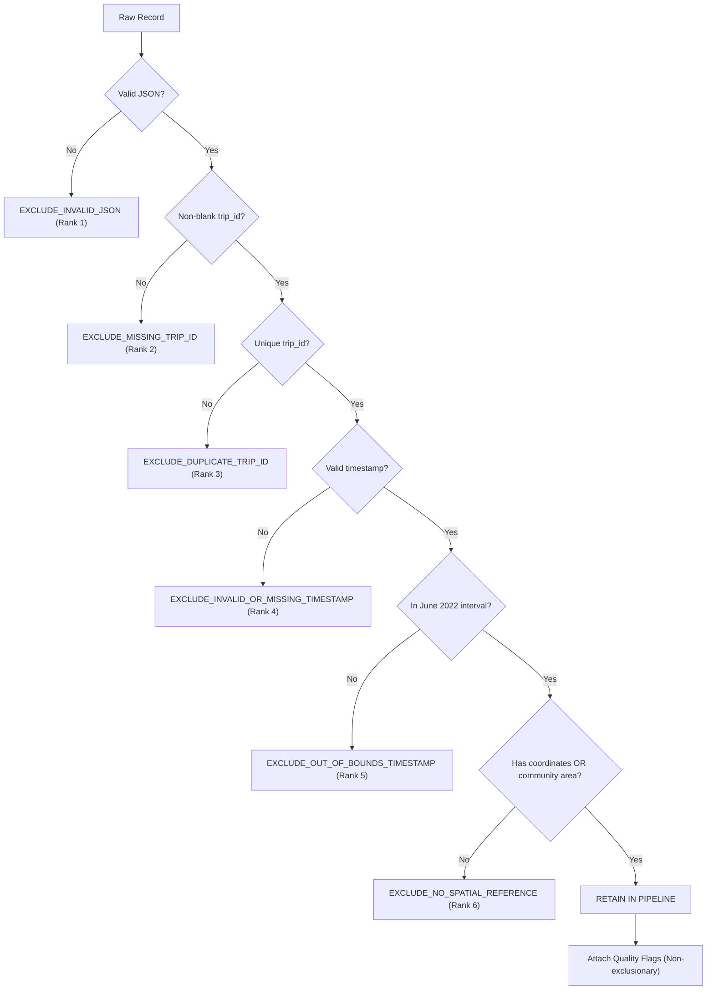

# RideIntel Cleaning Policy and Exclusion Audit Specification

STATUS: REVISED PROPOSAL (Task 3B)  
MACHINE-READABLE CONTRACT: `contracts/cleaning_reason_codes.json`  
AUDIT EVIDENCE SOURCE: `docs/evidence/raw_profile.json` (N = 639,269 records)

---

## 1. Principles & Architectural Boundary

The cleaning policy establishes a clear distinction between:
1. **Source Facts:** Unaltered historical records emitted by the City of Chicago Taxi Trips dataset (`wrvz-psew`), stored immutably in `data/raw/chicago_taxi_trips_2022-06.jsonl`.
2. **Cleaning Decisions:** Explicit, deterministic rules applied to filter or categorize records during ingestion into `data/interim/` and `data/processed/`.
3. **Assumptions:** Model and scenario parameters (e.g. vehicle capacity rate $r$, pressure thresholds, and 15-minute demand window sizing).

### Critical Rule on Demand Counting vs. Trip Metrics:
> [!IMPORTANT]
> A record is **not** discarded from pickup demand merely because `trip_miles <= 0`, `trip_seconds <= 0`, or `fare`/`tips` are zero or missing.
> 
> A taxi dispatch or street hail is a physical demand event that consumes driver attention and vehicle availability at timestamp $T$ and spatial cell $H$. Odometers, meters, or transaction logs frequently report 0 miles (meter reset failure, flat airport rate, cancellation after boarding) without nullifying the pickup event itself.
> 
> Therefore, this policy separates:
> - **Demand-Counting Filter:** Determines whether a record represents a spatially and temporally valid pickup in Chicago.
> - **Quality Flags:** Preserves records in the demand pipeline while flagging them so downstream speed, distance, or fare modeling can isolate or exclude them. Quality flags **never** reduce the demand count and **never** enter the exclusion reconciliation equation.

---

## 2. Spatial Rollups: Overlapping Eligibility vs. Mutually Exclusive Groups

RideIntel defines two parallel spatial rollups for pickup demand:
1. **H3 Gridded Demand (`demand_windows`):** Uniform hexagonal gridding for spatial ML forecasting and simulated vehicle pressure index calculation.
2. **Community Area Administrative Demand (`demand_community_area_windows`):** Administrative neighborhood rollups matching the 77 official City of Chicago Community Areas for public reporting.

> [!WARNING]
> **DO NOT SUM OVERLAPPING ELIGIBILITY COUNTS TOGETHER.**  
> `h3_eligible_rows` and `community_area_eligible_rows` represent overlapping, parallel perspectives on the same underlying physical trips. Summing them together double-counts trips (1,167,676 trips).

To prevent ambiguity, reporting must strictly separate **Overlapping Eligibility Counts** from **Mutually Exclusive Reconciliation Groups**.

### Concept A: Overlapping Eligibility Counts (How many qualify for each rollup)
- **`h3_eligible_rows` = 584,001 (91.355%):** Records possessing valid, non-null `pickup_centroid_latitude` and `pickup_centroid_longitude`. Deterministically mappable to an H3 index.
- **`community_area_eligible_rows` = 583,675 (91.304%):** Records possessing a valid, non-null `pickup_community_area` integer (1 to 77). Deterministically assignable to an administrative neighborhood.
- These counts overlap by 583,675 trips and must never be summed.

### Concept B: Mutually Exclusive Reconciliation Groups (Disjoint Partition)
The raw dataset is deterministically partitioned into four disjoint, mutually exclusive groups:

| Mutually Exclusive Group | Measured Count (June 2022) | Percentage | Definition & Policy Treatment |
| :--- | :--- | :--- | :--- |
| **`eligible_for_both`** | **583,675** | **91.304%** | Possesses both valid coordinates and valid community area. Included in both H3 and Community Area rollups. |
| **`h3_only`** | **326** | **0.051%** | Source coordinates present, but `pickup_community_area` is null in the source data. Cause is **UNKNOWN / UNVERIFIED** (unverified against GIS boundary shapefiles). Eligible for H3 gridded demand; excluded from named community-area rankings. |
| **`community_area_only`** | **0** | **0.000%** | Community area present, but coordinates null. In June 2022, whenever community area was present, coordinates were also provided. |
| **`neither` (`excluded_from_all_spatial_demand_rows`)** | **55,268** | **8.645%** | Lacks **both** coordinates and community area. Originated outside Chicago or suppressed for privacy. Excluded from all spatial rollups. |

### Reconciliation of Exclusive Groups:
$$\text{eligible\_for\_both (583,675)} + \text{h3\_only (326)} + \text{community\_area\_only (0)} + \text{neither (55,268)} = \mathbf{639,269}\text{ (Total Raw)}$$

### Derivation of Overlapping Counts from Exclusive Groups:
- $\text{h3\_eligible\_rows} = \text{eligible\_for\_both} + \text{h3\_only} = 583,675 + 326 = \mathbf{584,001}$
- $\text{community\_area\_eligible\_rows} = \text{eligible\_for\_both} + \text{community\_area\_only} = 583,675 + 0 = \mathbf{583,675}$
- Difference: Exactly 326 records (`584,001 - 583,675 = 326`).

---

## 3. Deterministic Exclusion Precedence & Quality Flags

To guarantee deterministic, balanced reconciliation, every excluded record is assigned **exactly one primary exclusion reason**. If a record fails multiple validation criteria, the reason with the lowest rank number (highest precedence) is assigned.

Retained records may carry **multiple quality flags** (non-exclusionary informational attributes).



### Precedence Table (Cases A through K)

| Case | Scenario | Measured Count (June 2022) | Pipeline Action | Code | Category | Precedence Rank |
| :--- | :--- | :--- | :--- | :--- | :--- | :--- |
| **J** | Malformed JSON line | 0 (0.00%) | **EXCLUDE** | `EXCLUDE_INVALID_JSON` | PRIMARY_EXCLUSION | **Rank 1** |
| **A** | Missing or blank `trip_id` | 0 (0.00%) | **EXCLUDE** | `EXCLUDE_MISSING_TRIP_ID` | PRIMARY_EXCLUSION | **Rank 2** |
| **I** | Duplicate `trip_id` | 0 (0.00%) | **EXCLUDE** | `EXCLUDE_DUPLICATE_TRIP_ID` | PRIMARY_EXCLUSION | **Rank 3** |
| **B** | Missing/unparseable timestamp | 0 (0.00%) | **EXCLUDE** | `EXCLUDE_INVALID_OR_MISSING_TIMESTAMP` | PRIMARY_EXCLUSION | **Rank 4** |
| **K** | Timestamp outside June 2022 | 0 (0.00%) | **EXCLUDE** | `EXCLUDE_OUT_OF_BOUNDS_TIMESTAMP` | PRIMARY_EXCLUSION | **Rank 5** |
| **C** | Missing coordinates AND community area | 55,268 (8.645%) | **EXCLUDE** | `EXCLUDE_NO_SPATIAL_REFERENCE` | PRIMARY_EXCLUSION | **Rank 6** |
| **D** | Coordinates present, community area null | 326 (0.051%) | **INCLUDE (H3)** | `FLAG_COMMUNITY_AREA_MISSING_COORDS_PRESENT` | QUALITY_FLAG | N/A (Flag) |
| **E** | Community area present, coordinates null | 0 (0.00%) | **INCLUDE (CA)**| `FLAG_COORDS_MISSING_COMMUNITY_PRESENT` | QUALITY_FLAG | N/A (Flag) |
| **F** | Non-positive `trip_miles` (`<= 0` or null)| 81,401 (12.73%) | **INCLUDE** | `FLAG_NON_POSITIVE_MILES` | QUALITY_FLAG | N/A (Flag) |
| **G** | Non-positive `trip_seconds` (`<= 0` or null)| 16,199 (2.53%) | **INCLUDE** | `FLAG_NON_POSITIVE_SECONDS` | QUALITY_FLAG | N/A (Flag) |
| **H1**| Zero or missing `fare` | 925 (0.14%) | **INCLUDE** | `FLAG_ZERO_OR_MISSING_FARE` | QUALITY_FLAG | N/A (Flag) |
| **H2**| Zero or missing `tips` (cash tip omission)| 287,053 (44.90%)| **INCLUDE** | `FLAG_ZERO_OR_MISSING_TIPS` | QUALITY_FLAG | N/A (Flag) |

---

## 4. Required Structural Decisions

### Decision 1: Minimum Fields Required to Count a Pickup
To qualify as an observed pickup in `demand_windows`:
1. `trip_id`: string, non-null, non-empty.
2. `trip_start_timestamp`: ISO datetime, successfully parsed and localized to Chicago local time.
3. Spatial location: valid `pickup_centroid_latitude` and `pickup_centroid_longitude` within WGS84 Chicago bounds.

### Decision 2: Deterministic Geographic Fallback Policy (No Fabricated Coordinates)
- **Primary:** Source-provided `(pickup_centroid_latitude, pickup_centroid_longitude)`.
- **Fallback Rule:** If coordinates are missing, under no circumstances will the pipeline fabricate synthetic lat/lon coordinates. Records lacking coordinates are tagged and directed to administrative Community Area rollups, maintaining 100% source provenance.

### Decision 3: Separate and Non-Additive Rollups
- H3 hexagonal gridding (`demand_windows`) is the primary input for spatial forecasting models and vehicle supply simulation.
- Community Area rollups (`demand_community_area_windows`) are maintained as a separate administrative view.
- The two rollups are non-additive; they must never be summed together.
- **Handling of the 326 Coordinate-Present / Community-Area-Missing Records:**
  - These records remain eligible for H3 gridded demand because source coordinates exist.
  - They are **not** assigned to named community-area rankings without a verified source assignment.
  - In administrative community-area rollups, they must be assigned to an explicitly labelled `COMMUNITY_AREA_UNKNOWN_UNVERIFIED` bucket, preserving separation from Chicago's 77 official named neighborhoods.

### Decision 4: Half-Open Date Range Definition
The target experimental interval is defined as:
$$\text{Interval} = [2022\text{-}06\text{-}01\text{T}00:00:00, 2022\text{-}07\text{-}01\text{T}00:00:00)$$
- **Local Time (`America/Chicago`):** Inclusive start `2022-06-01 00:00:00 CDT` (-05:00); exclusive end `2022-07-01 00:00:00 CDT` (-05:00).
- **UTC Storage:** Inclusive start `2022-06-01 05:00:00Z`; exclusive end `2022-07-01 05:00:00Z`.
- Filter condition: `2022-06-01T05:00:00Z <= event_ts_utc < 2022-07-01T05:00:00Z`.

### Decision 5: Stable Deterministic Event IDs
- Formula: `event_id = sha1(dataset_id + ":" + trip_id)`.
- Dataset ID: `"wrvz-psew"`.
- Properties: Event IDs are **deterministic identifiers** derived from the stable dataset ID and trip ID. While SHA-1 is a cryptographic hash subject to theoretical hash collisions on adversarial inputs, in this application it functions as a stable, reproducible pseudo-unique identifier across restarts, stream replays, and distributed partitions.
- Verified Example: `sha1("wrvz-psew:1331f7a37850d9673b465e85cffa6c369d5cf5af")` produces `ff02be5e897d08e2a23776d00ce17c73fa8960aa`.

### Decision 6: Output Datasets and Storage Formats
The ingestion pipeline produces three distinct persisted artifacts:
1. **Interim Cleaned Trips Dataset:** Parquet dataset directory (`data/interim/cleaned_trips_2022-06/`). Contains all retained records with parsed UTC timestamps, H3 indexes, and quality flags.
2. **Exclusion Audit Dataset:** Separate Parquet dataset directory (`data/interim/excluded_trips_2022-06/`). Contains all dropped records with their assigned single primary exclusion code and preserved source attributes.
3. **Run Summary:** Machine-readable JSON evidence file (`docs/evidence/clean_run_summary.json` and `reports/ingest_exclusion_audit.json`). Documents input counts, included counts by rollup, primary exclusions, quality flag totals, and the reconciliation check.

### Decision 7: Exclusion Audit Outputs & Reconciliation Checks
Every cleaning run must produce a verifiable audit report (`reports/ingest_exclusion_audit.json`):

$$\text{raw\_input\_rows} = \text{h3\_eligible\_rows} + \sum \text{primary\_exclusions\_h3}$$

```json
{
  "raw_input_rows": 639269,
  "overlapping_eligibility_counts": {
    "h3_eligible_rows": 584001,
    "community_area_eligible_rows": 583675
  },
  "mutually_exclusive_groups": {
    "eligible_for_both": 583675,
    "h3_only": 326,
    "community_area_only": 0,
    "neither": 55268
  },
  "reconciliation_check": {
    "balanced": true,
    "equation": "raw_input_rows == eligible_for_both + h3_only + community_area_only + neither",
    "discrepancy": 0
  },
  "primary_exclusions": {
    "EXCLUDE_INVALID_JSON": 0,
    "EXCLUDE_MISSING_TRIP_ID": 0,
    "EXCLUDE_DUPLICATE_TRIP_ID": 0,
    "EXCLUDE_INVALID_OR_MISSING_TIMESTAMP": 0,
    "EXCLUDE_OUT_OF_BOUNDS_TIMESTAMP": 0,
    "EXCLUDE_NO_SPATIAL_REFERENCE": 55268
  },
  "quality_flag_counts": {
    "FLAG_COMMUNITY_AREA_MISSING_COORDS_PRESENT": 326,
    "FLAG_NON_POSITIVE_MILES": 81401,
    "FLAG_NON_POSITIVE_SECONDS": 16199,
    "FLAG_ZERO_OR_MISSING_FARE": 925,
    "FLAG_ZERO_OR_MISSING_TIPS": 287053
  }
}
```
